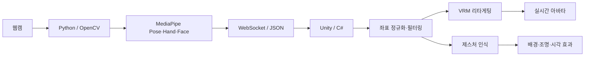

# MCSW — VirtualCharacterStudio

**단일 웹캠 기반 실시간 VRM 아바타 모션 캡처 및 제스처 제어 스튜디오**

MCSW(MotionCaptureSW)는 일반 RGB 웹캠의 영상을 Python·MediaPipe로 분석하고, 신체 자세·양손 관절·얼굴 표정 정보를 Unity의 VRM 아바타에 실시간 반영하는 졸업작품용 프로젝트입니다! 사용자는 별도 추적 서버를 수동으로 실행하지 않고 프로그램의 메인 메뉴에서 아바타를 선택해 스튜디오에 진입할 수 있도록 안내하고 있습니다.

> **대상 플랫폼:** Windows x64  
> **Unity 프로젝트 버전:** 2022.3.21f1  

## 프로그램 다운로드

**[Windows 실행 패키지 다운로드 — MCSW Release](https://github.com/Junho-Seox/MCSW/releases/tag/2027)**

Release 페이지에서 `VCS-Windows.zip`을 다운로드하고 압축을 해제한 다음, 폴더에 포함된 Unity 실행 파일(`.exe`)을 실행합니다.

- 웹캠이 연결된 Windows PC가 필요합니다.
- 배포 패키지에는 Python 추적 백엔드가 함께 포함되도록 구성하였습니다. 일반 사용자는 개발용 `.venv`를 설치하지 않아도 됩니다.
- 카메라 접근 권한 및 Windows 보안 설정에 따라 최초 실행 시 권한 확인이 필요할 수 있습니다.
- 서로 다른 PC 환경에서의 호환성은 별도 확인이 필요합니다. 현재는 Windows x64에서만 구동을 확인하였습니다.

## 주요 기능

| 구분 | 주요 기능 |
|---|---|
| 실시간 자세 추적 | MediaPipe Pose Landmarker의 3차원 World Landmarks를 이용한 상반신 자세 추정 |
| 손 및 손가락 추적 | 양손의 Hand World Landmarks를 활용한 손목·손가락 동작 제어 |
| 얼굴 표정 | Face Landmarker의 Blendshape 점수를 VRM 표정으로 반영 |
| 아바타 리타게팅 | Unity Humanoid 뼈대 매핑, 좌표 정규화, One Euro 필터, 팔 2-Bone IK 및 추적 손실 복구 |
| 아바타 선택 | 남성·여성 아바타 선택, 3D 미리보기 회전 및 확대·축소 |
| 제스처 제어 | 양손 가로 스와이프로 배경 변경, 아래쪽 스와이프로 조명 변경 |
| 시각적 이벤트 | 양손을 앞으로 뻗어 방패 효과, 양손을 귀 부근에 유지해 헤드셋 효과 |
| 통합 실행 | 아바타 선택 후 Python 자동 실행, 실제 자세 데이터 수신 확인, 스튜디오 진입 |

현재 핵심 추적 범위는 **머리·상체·팔·손·얼굴**입니다. 전신 모션 캡처를 목표로 하는 구현은 아닙니다.

## 프로그램 사용 방법

1. `VCS-Windows.zip`을 다운로드하여 **전체 내용을 압축 해제**합니다.
2. 압축 해제한 폴더에서 Unity 실행 파일을 실행합니다.
3. 메인 메뉴에서 **시작하기**를 선택합니다.
4. 사용할 **아바타**를 선택하고 **다음**을 누릅니다.
5. 프로그램이 Python 추적 백엔드와 웹캠을 준비합니다. 상반신이 카메라에 보이도록 위치를 조정합니다.
6. 자세 추적 준비 완료 메시지를 확인한 뒤, 최초 실행 안내 화면을 거쳐 스튜디오로 진입합니다.
7. 스튜디오에서 몸·손·표정 움직임을 반영하거나 제스처로 배경과 효과를 변경합니다.

**참고:** 추적 준비 화면에서는 웹캠 미리보기 창을 별도로 표시하지 않을 수 있습니다. 화면의 준비 상태는 WebSocket을 통한 유효한 자세 데이터 수신 여부로 판단합니다.

## 시스템 구조



Python에서 계산한 추적 결과를 `ws://127.0.0.1:8765`로 전달합니다. Unity는 패킷의 자세·손·얼굴 데이터를 받아 리타게팅 및 제스처 이벤트에 사용합니다. 영상 원본 대신 추론 결과를 전송합니다.

## 기술 스택

| 영역 | 기술 |
|---|---|
| 클라이언트 / 3D 렌더링 | Unity 2022.3.21f1, C# |
| 아바타 | VRM, UniVRM, Unity Humanoid |
| 인체 추정 | Python, MediaPipe Tasks Vision (Pose / Hand / Face) |
| 영상 처리 | OpenCV |
| 실시간 통신 | WebSocket, JSON, NativeWebSocket |
| 안정화 / 리타게팅 | One Euro Filter, 좌표 정규화, 2-Bone IK |
| 배포 | PyInstaller, Unity Windows Build, PowerShell, GitHub Releases |

## 저장소 구조

```text
MCSW/
├── VCStudio/              
│   ├── Assets/
│   ├── Packages/
│   └── ProjectSettings/
├── TrackingService/        
│   ├── main.py
│   ├── websocket_server.py
│   ├── models/
│   └── requirements.txt
├── Scripts/      
│   ├── BuildBackend.ps1
│   └── PrepareRelease.ps1
├── docs/          
│   └── MCSW_DEVELOPMENT.md
└── README.md
```

Unity의 `Library/`, Python의 `.venv/`, 생성된 빌드 결과물 등은 Git 소스 관리 대상에서 제외합니다. 완성된 Windows 실행 패키지는 [GitHub Releases](https://github.com/Junho-Seox/MCSW/releases/tag/MCSW)로 제공하겠습니다.

## 개발 환경에서 소스코드 실행

Windows 환경에서 **Unity 2022.3.21f1**과 호환되는 Python을 준비합니다. Python 3.11을 사용하는 경우의 명령 예시는 다음과 같습니다.

```powershell
cd TrackingService
py -3.11 -m venv .venv
.\.venv\Scripts\python.exe -m pip install -r requirements.txt
```

`TrackingService/models/`에 `pose_landmarker_full.task`, `hand_landmarker.task`, `face_landmarker.task`가 존재해야 합니다.

다음으로 Unity Hub에서 `VCStudio/` 폴더를 엽니다. `VCSStudioAppConfig`에서 **Manage Python Process** 옵션을 활성화하고 메인 메뉴 씬을 실행하면 아바타 선택 이후 백엔드를 자동으로 실행합니다. 상대 경로가 올바르게 동작하려면 `VCStudio/`와 `TrackingService/`가 같은 상위 폴더에 있어야 합니다.

Python만 독립적으로 테스트하려면 다음 명령을 사용합니다.

```powershell
cd TrackingService
.\.venv\Scripts\python.exe main.py
```

독립 실행 테스트를 종료한지 않고 Unity를 실행하면 WebSocket 포트 관련 에러가 발생할 수 있습니다.

---

## 개발 문서

개발 문서에는 추적 데이터 구조, 좌표 처리, VRM 리타게팅, 제스처 인식, 자동 실행 및 배포 구조, 개발 과정의 문제 해결 사례 등을 상세히 정리했습니다.

## 알려진 제약 및 참고사항

- 단일 RGB 카메라 기반 추정이므로 팔을 카메라 정면으로 뻗거나 관절이 가려지는 상황에서 깊이·관절 방향 오차가 발생할 수 있습니다.
- 손·얼굴 추적 정확도는 조명, 카메라 위치, 가림 정도 등에 영향을 받습니다.
- 현재 Windows x64 기반으로 개발·패키징되었습니다. 다른 운영체제용 실행 파일은 제공하지 않습니다.
- 사용한 VRM 모델 및 외부 에셋의 재배포 조건은 각 라이선스에 따릅니다. 현재 사용된 모델이나 에셋 등은 라이선스에 아무런 문제가 되지 않습니다.

---

**Repository:** https://github.com/Junho-Seox/MCSW  
**Release:** https://github.com/Junho-Seox/MCSW/releases/tag/MCSW
